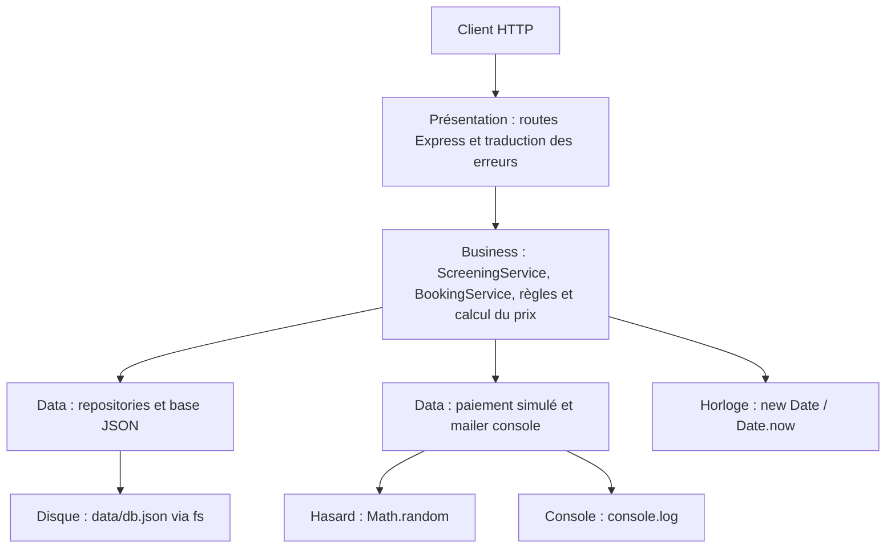

# TP1 — Audit et découpage en couches de CinéResa

## Cartographie du legacy

Les numéros ci-dessous correspondent au `src/server.ts` fourni avant le découpage.

| Lignes legacy | Responsabilité | Couche |
|---|---|---|
| 3–8 | Import et initialisation Express, middleware JSON | Présentation |
| 10–18 | Chemin, lecture et écriture de `data/db.json` | Données |
| 23–43 | Route `GET /screenings`, filtrage et réponse HTTP | Présentation + métier + données |
| 49–107 | Route `POST /screenings/:id/bookings`, validation, disponibilité, prix, paiement, persistance, mail et réponse HTTP | Présentation + métier + données |
| 112–130 | Route `DELETE /bookings/:id`, règles d’annulation, persistance, mail et réponse HTTP | Présentation + métier + données |
| 135–144 | Route `GET /bookings`, association des séances et réponse HTTP | Présentation + métier + données |
| 146–149 | Port et démarrage du serveur | Présentation / infrastructure |
| 84–85 | Simulation de paiement par `Math.random()` | Infrastructure |
| 101–104, 128 | Simulation du mail avec `console.log` | Infrastructure |
| 25, 28, 64, 88, 95, 119, 125 | Lecture de l’horloge et génération d’identifiants/dates | Infrastructure utilisée par le métier |

Après refactorisation, les routes sont dans `src/presentation`, les règles et services dans `src/business`, et les adaptateurs JSON, paiement et mail dans `src/data`.

## Code smells du legacy

| Smell | Lignes | Conséquence concrète |
|---|---:|---|
| God object / fichier monolithique | 1–151 | Une modification métier implique de comprendre les routes, les données et les effets externes du même fichier. |
| Responsabilités multiples (SRP) | 23–144 | Les handlers valident, calculent, persistent et produisent des effets secondaires; ils changent pour des raisons indépendantes. |
| Duplication de logique | 29–32 et 69–72 | Le comptage des places confirmées peut diverger lors d’une correction; ce calcul est maintenant centralisé. |
| Couplage fort aux détails de stockage | 12–17, 24, 50, 113, 136 | Le métier dépend directement d’un chemin de fichier, du format JSON et des appels synchrones à `fs`. |
| Dépendances non remplaçables / testabilité faible | 84, 88, 95, 119, 125 | Temps, hasard, disque et console sont appelés directement; les tests isolés nécessiteraient de modifier ou mocker le module complet. |
| Types contournés par `any` | 12–17, 51, 114, 137, 140 | Les erreurs de forme du stockage et les incohérences de propriétés ne sont pas détectées par TypeScript. |
| Mélange HTTP/métier | 52–85, 115–122 | Les règles sont exprimées sous forme de réponses et statuts HTTP; un autre point d’entrée ne peut pas les réutiliser proprement. |
| Nombres magiques | 60, 79, 81, 84, 120 | Les bornes, remises, seuils et délais sont dispersés et difficiles à nommer ou modifier sans oubli. |
| Mutations en place et persistance complète | 97–98, 124–126 | Le flux métier connaît le modèle de stockage; l’écriture doit réencoder tout le document pour un seul changement. |
| Dépendance implicite à l’heure et aux effets de bord | 25, 64, 84–95, 119–128 | Résultats sensibles au temps/hasard et effets difficiles à contrôler dans un test reproductible. |

## Découpage et direction des dépendances

Le sens entre couches est `presentation → business → data`. Aucun module de `business` n’importe Express ni ne reçoit `req`/`res`; les codes et corps HTTP sont centralisés dans `presentation/errorHandler.ts`. Les services créent eux-mêmes les repositories comme demandé dans l’énoncé.

### Dépendances de `POST /screenings/:id/bookings`

| Dépendance | Utilisation | Remplaçable dans un test sans modifier le code ? |
|---|---|---|
| Express / requête et réponse HTTP | `presentation/routes.ts` | Oui pour tester le handler via Supertest; non pour appeler le service avec HTTP, mais les règles métier n’en dépendent pas. |
| Repositories | `BookingService` crée ses repositories | Pas directement avec l’API actuelle : les services instancient les classes concrètes. Il faudrait mocker le module ou changer le code/injection. |
| Fichier JSON / `fs` | `database.ts` lit et écrit `data/db.json` | Non par injection; les tests de service actuels liraient/écriraient le fichier réel. |
| Temps (`new Date()`, `Date.now()`) | Vérification de séance, identifiant et horodatage | Non par injection sans modifier le code; un mock global de timers/date reste possible dans l’environnement de test. |
| Hasard (`Math.random()`) | `payment.ts` accepte/refuse le paiement | Non avec l’interface actuelle; un espion global peut le remplacer dans un test, mais il n’est pas injecté. |
| Console (`console.log`) | `mailer.ts` simule le mail | Non par injection; un spy global permet de vérifier l’appel sans modifier le code. |

## SOLID dans le legacy

| Lettre | Violation / applicabilité |
|---|---|
| **S — Single Responsibility** | `server.ts` initialise Express, expose les routes, applique les règles, lit/écrit le JSON, simule paiement et mails (lignes 3–149). Il a plusieurs raisons de changer. |
| **O — Open/Closed** | Ajouter un autre stockage ou prestataire oblige à modifier directement les handlers (12–17, 84, 101–104), au lieu d’étendre un adaptateur derrière un contrat. |
| **L — Liskov Substitution** | Aucune hiérarchie/polymorphisme explicite à substituer dans le legacy; le principe est peu applicable directement. Le couplage aux fonctions concrètes empêche néanmoins les substituts. |
| **I — Interface Segregation** | Il n’existe aucune interface; les handlers accèdent à une structure `any` commune, sans contrats étroits séparant lecture, écriture et effets externes. |
| **D — Dependency Inversion** | Le flux de haut niveau appelle directement `fs`, `Math.random()` et `console.log` (12–17, 84, 101–104), plutôt que des abstractions remplaçables. |

## Bilan — testabilité après découpage

Le calcul de prix est une fonction pure dans `src/business/pricing.ts` et ses tests Vitest n’ont besoin ni du serveur, ni du disque. Les règles de validation (email, nombre de places, séance commencée, capacité, tarif), de capacité restante, d’annulation et d’association des séances sont maintenant exprimées dans les services et peuvent être testées sans démarrer Express **si** leurs repositories, l’horloge, le paiement et le mailer sont remplacés. Avec l’instanciation concrète actuelle imposée comme limite pédagogique, elles ne sont pas encore isolables de `data/db.json` et des effets annexes sans mocker des modules/globals ou changer les services.

Restent impossibles à tester de façon déterministe sans remplacement des dépendances : les comparaisons temporelles, l’ID basé sur `Date.now()`, le résultat aléatoire du paiement, ainsi que l’écriture disque et les mails. Le TP2 pourra introduire l’injection d’interfaces pour les rendre substituables. Les quatre routes restent accessibles avec les mêmes méthodes, chemins, statuts et formes de réponses que le legacy.
